# CSC 869 Mini Project 2 -- Python implementation report draft

This file is generated from `results/*.csv`; regenerate it with `python -m csc869.run --config configs/main.yaml --out results/`. The brief's newer limit is **6 pages**; the older rubric says 3. This draft is a content source, not a typeset PDF.

## 1. Data and preprocessing

- Training rows: **32,561**; test rows: **16,281**.
- Training class balance: **>50K 24.08%** / <=50K 75.92%.
- Test class balance: **>50K 23.62%** / <=50K 76.38%.
- Missing values are confined to `workclass`, `occupation`, and `native-country`; they are encoded as `?` in the raw files and mapped to null.
- Two categorical strategies are implemented: `unknown` (missing as its own category) and `mode` (training-mode imputation). Two numeric strategies are implemented: `median` and `median + missing indicator`. Adult has no missing numeric values, so the numeric variants are identical in practice; this is reported rather than faked. The real numeric issues are the zero-inflated `capital-gain`/`capital-loss` features and `hours-per-week` outliers, shown in the capital-gain figure.
- All preprocessing statistics (modes, medians, means, standard deviations, one-hot vocabularies) are fitted **inside each fold** on the resampled training rows only.


Missing-value strategy ablation (decision tree, 5-fold CV):

| categorical_strategy | numeric_strategy | metric | mean | std | n_folds |
|---|---|---|---|---|---|
| mode | indicator | accuracy | 0.8531 | 0.0061 | 5 |
| mode | indicator | f1 | 0.6624 | 0.0082 | 5 |
| mode | indicator | pr_auc | 0.7559 | 0.0103 | 5 |
| mode | median | accuracy | 0.8531 | 0.0061 | 5 |
| mode | median | f1 | 0.6624 | 0.0082 | 5 |
| mode | median | pr_auc | 0.7559 | 0.0103 | 5 |
| unknown | indicator | accuracy | 0.8525 | 0.0069 | 5 |
| unknown | indicator | f1 | 0.6615 | 0.0096 | 5 |
| unknown | indicator | pr_auc | 0.7545 | 0.0139 | 5 |
| unknown | median | accuracy | 0.8525 | 0.0069 | 5 |
| unknown | median | f1 | 0.6615 | 0.0096 | 5 |
| unknown | median | pr_auc | 0.7545 | 0.0139 | 5 |


## 2. Methods

- Classifiers: Decision Tree (Gini, depth tuned by inner 3-fold F1), Random Forest (300 trees), Logistic Regression (L2, max_iter=1000), SVM (RBF, Platt-calibrated for the final test model), KNN (k=5, ball tree, scaled features).
- Sampling scenarios: `none`, random `upsampling` of the minority to parity, and random `downsampling` of the majority to the minority count. Resampling is applied only to the training portion of each fold.
- Evaluation: stratified 5-fold CV (seed 42, frozen in `data/folds.json`), six metrics (accuracy, precision, recall, F1, ROC-AUC, PR-AUC), ROC/PR curves, and learning curves.
- Metric definitions: precision = TP/(TP+FP), recall = TP/(TP+FN), F1 = 2PR/(P+R), ROC-AUC is the tie-aware Mann-Whitney statistic, and PR-AUC is average precision. All six are computed locally in `csc869.metrics`; the tests compare them against scikit-learn on random data.
- Curves: ROC and PR curves are averaged over the five folds on a common grid and plotted with a +/-1 standard-deviation band, one panel per sampling scenario. Learning curves use training fractions 0.1-1.0 on the first fold (decision-tree depth fixed at 7 for the curve sweep to avoid re-tuning at every fraction).
- Error analysis: a fixed 200-record test sample (100 positives + 100 negatives), a 3-family Venn of misclassification sets, a 5x5 pairwise agreement heatmap, and FP/FN counts per model and scenario.
- MP1 carry-forward: a from-scratch mixed Naive Bayes with Laplace smoothing, a from-scratch stratified k-fold routine, and a from-scratch metrics module remain in `csc869.legacy`, `csc869.kfold`, and `csc869.metrics`.


## 3. Exploratory figures


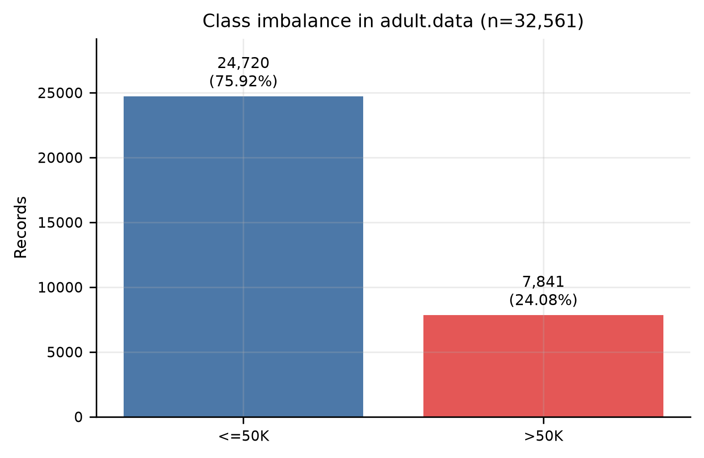

*24.08% positive: accuracy alone would reward a constant <=50K predictor at 75.92%.*


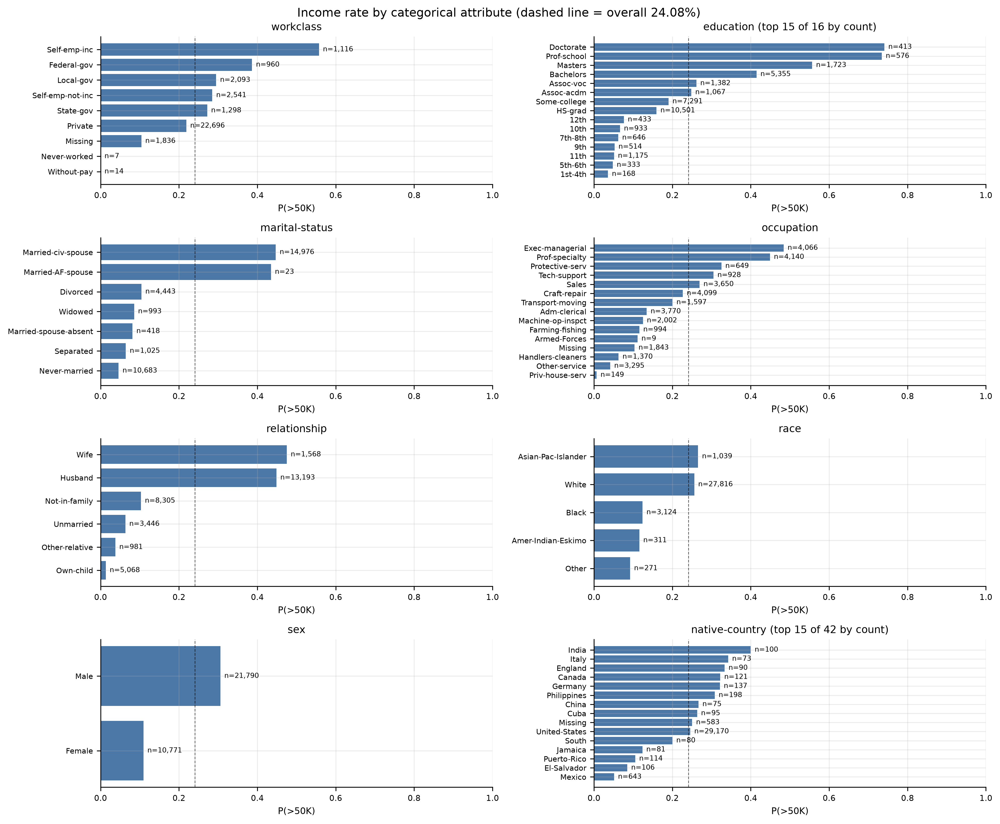

*Income rate by categorical attribute; missingness itself is informative.*


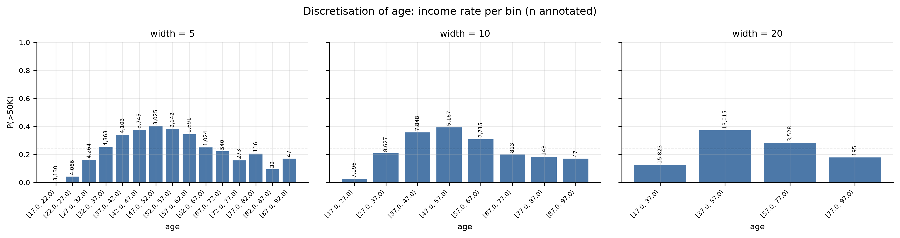

*Age bins: income rises through mid-career and flattens late.*


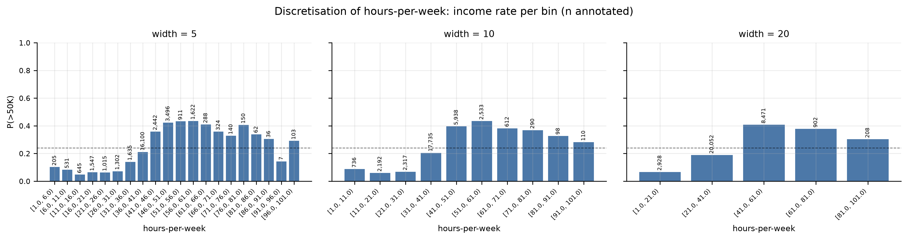

*Hours bins: part-time work is associated with a very low >50K rate.*


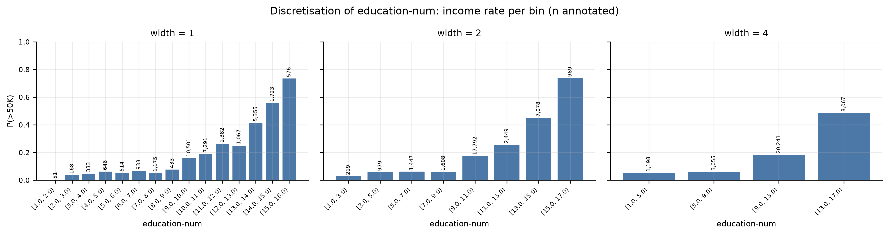

*Education bins: the >50K rate rises steeply with education-num.*


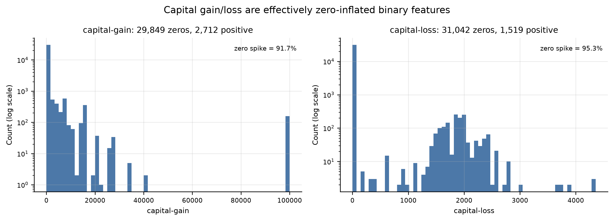

*Capital gain/loss are zero-inflated; the zero spike explains tree over-reliance.*


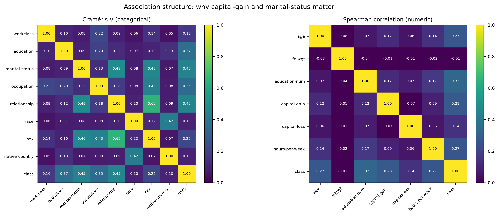

*Cramér's V and Spearman association structure.*


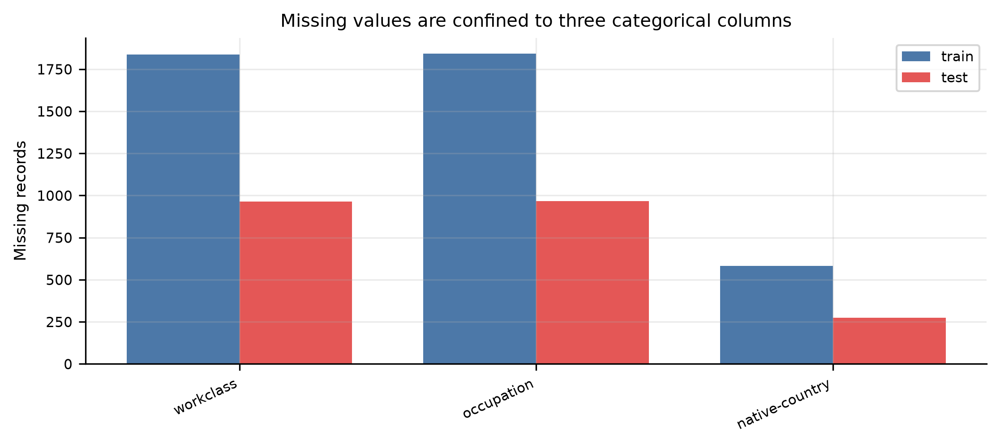

*Missingness is confined to three categorical columns.*


## 4. 5-fold CV results

Mean CV scores by model and sampling scenario (full tidy data in `results/cv_tidy.csv`):

| model | scenario | accuracy | f1 | pr_auc | roc_auc |
|---|---|---|---|---|---|
| SVM (RBF) | downsampling | 0.8049 | 0.6818 | 0.7552 | 0.9062 |
| Logistic Regression | downsampling | 0.8101 | 0.6815 | 0.7621 | 0.9055 |
| Random Forest | downsampling | 0.8119 | 0.6810 | 0.7474 | 0.9043 |
| Decision Tree | downsampling | 0.7972 | 0.6715 | 0.7139 | 0.8944 |
| KNN (k=5) | downsampling | 0.7699 | 0.6284 | 0.5817 | 0.8491 |
| Random Forest | none | 0.8569 | 0.6813 | 0.7701 | 0.9054 |
| Logistic Regression | none | 0.8517 | 0.6615 | 0.7671 | 0.9066 |
| Decision Tree | none | 0.8525 | 0.6615 | 0.7545 | 0.8957 |
| SVM (RBF) | none | 0.8555 | 0.6612 | 0.7694 | 0.9020 |
| KNN (k=5) | none | 0.8224 | 0.6062 | 0.6094 | 0.8397 |
| Random Forest | upsampling | 0.8494 | 0.6905 | 0.7479 | 0.9020 |
| SVM (RBF) | upsampling | 0.8101 | 0.6856 | 0.7460 | 0.9046 |
| Logistic Regression | upsampling | 0.8109 | 0.6820 | 0.7651 | 0.9064 |
| Decision Tree | upsampling | 0.8134 | 0.6123 | 0.4684 | 0.7446 |
| KNN (k=5) | upsampling | 0.7647 | 0.6081 | 0.5455 | 0.8225 |


**What the matrix shows.**

- `none`: best F1 **0.6813** with Random Forest (accuracy 0.8569, PR-AUC 0.7701).

- `upsampling`: best F1 **0.6905** with Random Forest (accuracy 0.8494, PR-AUC 0.7479).

- `downsampling`: best F1 **0.6818** with SVM (RBF) (accuracy 0.8049, PR-AUC 0.7552).

- Highest PR-AUC overall: **0.7701** with Random Forest under `none`.

- Accuracy alone is misleading: the best no-resampling models sit around 0.85-0.86 accuracy but only ~0.66-0.68 F1, while a constant `<=50K` predictor already scores 0.7592 accuracy and 0 F1.


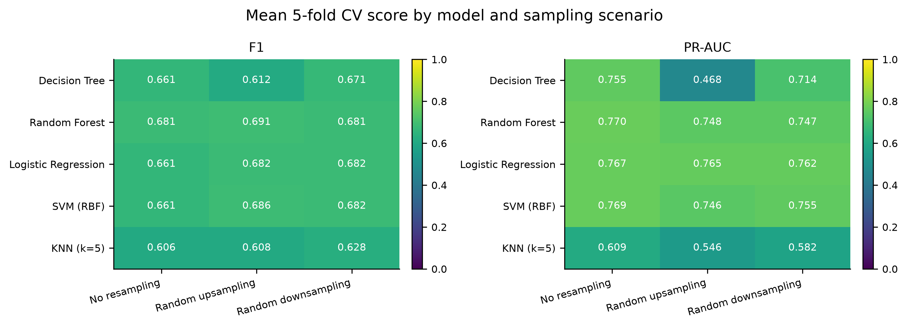


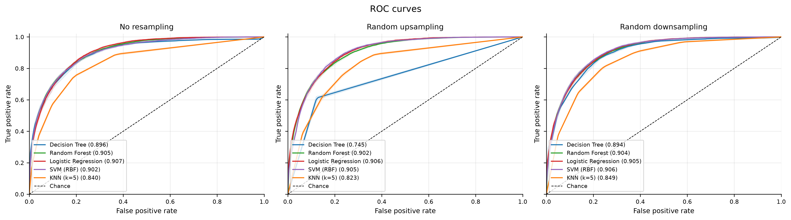


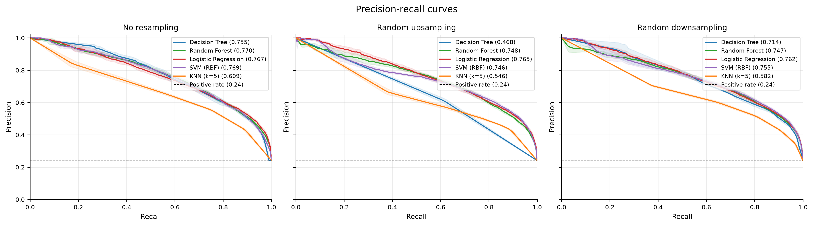


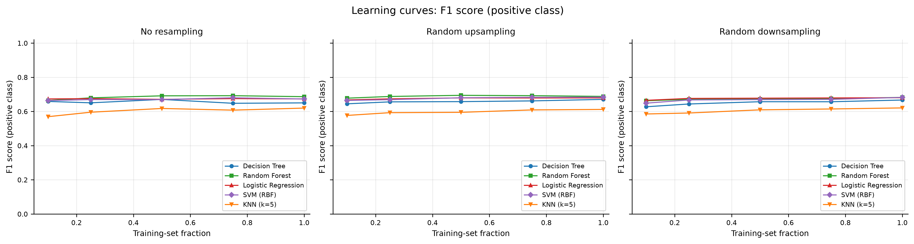


## 5. Test-set evaluation and CV-vs-test delta

| model | scenario | accuracy | precision | recall | f1 | pr_auc | roc_auc |
|---|---|---|---|---|---|---|---|
| SVM (RBF) | downsampling | 0.8140 | 0.5713 | 0.8510 | 0.6837 | 0.7479 | 0.9043 |
| Random Forest | downsampling | 0.8109 | 0.5684 | 0.8292 | 0.6745 | 0.7392 | 0.9016 |
| Logistic Regression | downsampling | 0.8072 | 0.5613 | 0.8414 | 0.6734 | 0.7579 | 0.9036 |
| Decision Tree | downsampling | 0.8047 | 0.5586 | 0.8248 | 0.6661 | 0.7217 | 0.8964 |
| KNN (k=5) | downsampling | 0.7664 | 0.5035 | 0.7938 | 0.6161 | 0.5655 | 0.8456 |
| Decision Tree | none | 0.8605 | 0.7613 | 0.5962 | 0.6687 | 0.7602 | 0.8990 |
| SVM (RBF) | none | 0.8591 | 0.7639 | 0.5840 | 0.6620 | 0.7688 | 0.9006 |
| Random Forest | none | 0.8512 | 0.7187 | 0.6079 | 0.6587 | 0.7619 | 0.9016 |
| Logistic Regression | none | 0.8527 | 0.7292 | 0.5985 | 0.6574 | 0.7622 | 0.9044 |
| KNN (k=5) | none | 0.8242 | 0.6457 | 0.5663 | 0.6034 | 0.6002 | 0.8370 |
| SVM (RBF) | upsampling | 0.8164 | 0.5761 | 0.8427 | 0.6843 | 0.7349 | 0.9018 |
| Logistic Regression | upsampling | 0.8077 | 0.5622 | 0.8404 | 0.6737 | 0.7599 | 0.9038 |
| Random Forest | upsampling | 0.8437 | 0.6661 | 0.6784 | 0.6722 | 0.7437 | 0.8992 |
| Decision Tree | upsampling | 0.8156 | 0.6088 | 0.6134 | 0.6111 | 0.4647 | 0.7457 |
| KNN (k=5) | upsampling | 0.7636 | 0.4997 | 0.7535 | 0.6009 | 0.5307 | 0.8193 |


Delta = test minus mean CV. Negative values are expected: the test split has a slightly lower positive rate (23.62% vs 24.08%) and a small distribution shift.

| model | scenario | metric | cv_mean | test | delta_test_minus_cv |
|---|---|---|---|---|---|
| Decision Tree | downsampling | accuracy | 0.7972 | 0.8047 | 0.0075 |
| Decision Tree | downsampling | f1 | 0.6715 | 0.6661 | -0.0054 |
| Decision Tree | downsampling | pr_auc | 0.7139 | 0.7217 | 0.0078 |
| KNN (k=5) | downsampling | accuracy | 0.7699 | 0.7664 | -0.0036 |
| KNN (k=5) | downsampling | f1 | 0.6284 | 0.6161 | -0.0123 |
| KNN (k=5) | downsampling | pr_auc | 0.5817 | 0.5655 | -0.0162 |
| Logistic Regression | downsampling | accuracy | 0.8101 | 0.8072 | -0.0029 |
| Logistic Regression | downsampling | f1 | 0.6815 | 0.6734 | -0.0081 |
| Logistic Regression | downsampling | pr_auc | 0.7621 | 0.7579 | -0.0042 |
| Random Forest | downsampling | accuracy | 0.8119 | 0.8109 | -0.0010 |
| Random Forest | downsampling | f1 | 0.6810 | 0.6745 | -0.0065 |
| Random Forest | downsampling | pr_auc | 0.7474 | 0.7392 | -0.0082 |
| SVM (RBF) | downsampling | accuracy | 0.8049 | 0.8140 | 0.0091 |
| SVM (RBF) | downsampling | f1 | 0.6818 | 0.6837 | 0.0019 |
| SVM (RBF) | downsampling | pr_auc | 0.7552 | 0.7479 | -0.0073 |
| Decision Tree | none | accuracy | 0.8525 | 0.8605 | 0.0080 |
| Decision Tree | none | f1 | 0.6615 | 0.6687 | 0.0073 |
| Decision Tree | none | pr_auc | 0.7545 | 0.7602 | 0.0057 |
| KNN (k=5) | none | accuracy | 0.8224 | 0.8242 | 0.0018 |
| KNN (k=5) | none | f1 | 0.6062 | 0.6034 | -0.0028 |
| KNN (k=5) | none | pr_auc | 0.6094 | 0.6002 | -0.0092 |
| Logistic Regression | none | accuracy | 0.8517 | 0.8527 | 0.0009 |
| Logistic Regression | none | f1 | 0.6615 | 0.6574 | -0.0041 |
| Logistic Regression | none | pr_auc | 0.7671 | 0.7622 | -0.0049 |
| Random Forest | none | accuracy | 0.8569 | 0.8512 | -0.0057 |
| Random Forest | none | f1 | 0.6813 | 0.6587 | -0.0226 |
| Random Forest | none | pr_auc | 0.7701 | 0.7619 | -0.0082 |
| SVM (RBF) | none | accuracy | 0.8555 | 0.8591 | 0.0036 |
| SVM (RBF) | none | f1 | 0.6612 | 0.6620 | 0.0007 |
| SVM (RBF) | none | pr_auc | 0.7694 | 0.7688 | -0.0006 |
| Decision Tree | upsampling | accuracy | 0.8134 | 0.8156 | 0.0022 |
| Decision Tree | upsampling | f1 | 0.6123 | 0.6111 | -0.0012 |
| Decision Tree | upsampling | pr_auc | 0.4684 | 0.4647 | -0.0037 |
| KNN (k=5) | upsampling | accuracy | 0.7647 | 0.7636 | -0.0011 |
| KNN (k=5) | upsampling | f1 | 0.6081 | 0.6009 | -0.0071 |
| KNN (k=5) | upsampling | pr_auc | 0.5455 | 0.5307 | -0.0148 |
| Logistic Regression | upsampling | accuracy | 0.8109 | 0.8077 | -0.0032 |
| Logistic Regression | upsampling | f1 | 0.6820 | 0.6737 | -0.0083 |
| Logistic Regression | upsampling | pr_auc | 0.7651 | 0.7599 | -0.0053 |
| Random Forest | upsampling | accuracy | 0.8494 | 0.8437 | -0.0057 |
| Random Forest | upsampling | f1 | 0.6905 | 0.6722 | -0.0184 |
| Random Forest | upsampling | pr_auc | 0.7479 | 0.7437 | -0.0042 |
| SVM (RBF) | upsampling | accuracy | 0.8101 | 0.8164 | 0.0062 |
| SVM (RBF) | upsampling | f1 | 0.6856 | 0.6843 | -0.0013 |
| SVM (RBF) | upsampling | pr_auc | 0.7460 | 0.7349 | -0.0111 |


## 6. Error analysis


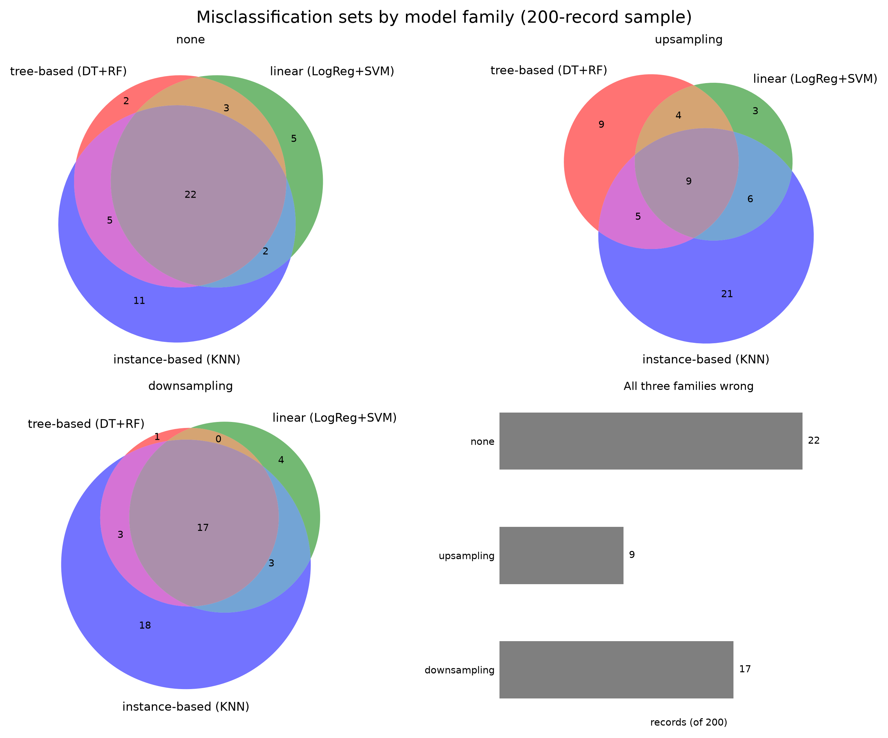


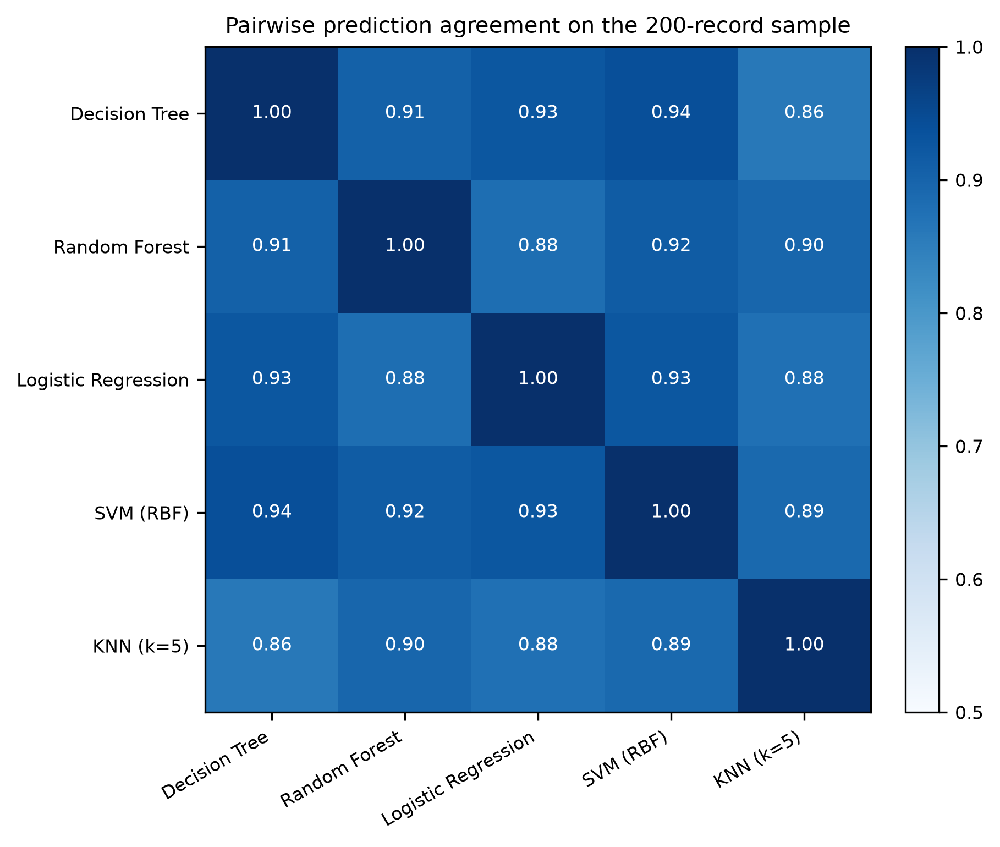


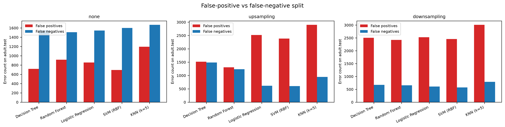


Venn region counts (200-record sample):

| region | count | scenario |
|---|---|---|
| tree-based (DT+RF) only | 2 | none |
| linear (LogReg+SVM) only | 5 | none |
| instance-based (KNN) only | 11 | none |
| tree-based (DT+RF) & linear (LogReg+SVM) only | 3 | none |
| tree-based (DT+RF) & instance-based (KNN) only | 5 | none |
| linear (LogReg+SVM) & instance-based (KNN) only | 2 | none |
| all three wrong | 22 | none |
| at least one family wrong | 50 | none |
| tree-based (DT+RF) only | 9 | upsampling |
| linear (LogReg+SVM) only | 3 | upsampling |
| instance-based (KNN) only | 21 | upsampling |
| tree-based (DT+RF) & linear (LogReg+SVM) only | 4 | upsampling |
| tree-based (DT+RF) & instance-based (KNN) only | 5 | upsampling |
| linear (LogReg+SVM) & instance-based (KNN) only | 6 | upsampling |
| all three wrong | 9 | upsampling |
| at least one family wrong | 57 | upsampling |
| tree-based (DT+RF) only | 1 | downsampling |
| linear (LogReg+SVM) only | 4 | downsampling |
| instance-based (KNN) only | 18 | downsampling |
| tree-based (DT+RF) & linear (LogReg+SVM) only | 0 | downsampling |
| tree-based (DT+RF) & instance-based (KNN) only | 3 | downsampling |
| linear (LogReg+SVM) & instance-based (KNN) only | 3 | downsampling |
| all three wrong | 17 | downsampling |
| at least one family wrong | 46 | downsampling |


Pairwise agreement (focus scenario):

| model_a | model_b | agreement | n |
|---|---|---|---|
| decision_tree | decision_tree | 1.0000 | 200 |
| decision_tree | random_forest | 0.9050 | 200 |
| decision_tree | logistic_regression | 0.9250 | 200 |
| decision_tree | svm | 0.9400 | 200 |
| decision_tree | knn | 0.8600 | 200 |
| random_forest | decision_tree | 0.9050 | 200 |
| random_forest | random_forest | 1.0000 | 200 |
| random_forest | logistic_regression | 0.8800 | 200 |
| random_forest | svm | 0.9150 | 200 |
| random_forest | knn | 0.8950 | 200 |
| logistic_regression | decision_tree | 0.9250 | 200 |
| logistic_regression | random_forest | 0.8800 | 200 |
| logistic_regression | logistic_regression | 1.0000 | 200 |
| logistic_regression | svm | 0.9250 | 200 |
| logistic_regression | knn | 0.8750 | 200 |
| svm | decision_tree | 0.9400 | 200 |
| svm | random_forest | 0.9150 | 200 |
| svm | logistic_regression | 0.9250 | 200 |
| svm | svm | 1.0000 | 200 |
| svm | knn | 0.8900 | 200 |
| knn | decision_tree | 0.8600 | 200 |
| knn | random_forest | 0.8950 | 200 |
| knn | logistic_regression | 0.8750 | 200 |
| knn | svm | 0.8900 | 200 |
| knn | knn | 1.0000 | 200 |


Named error patterns:

| scenario | pattern | count | denominator | rate | note |
|---|---|---|---|---|---|
| none | high_capital_gain_low_hours | 0 | 22 | 0.0000 | all five models wrong; capital-gain > 0 and hours-per-week < 40 |
| none | mid_education_band_9_13 | 20 | 22 | 0.9091 | all five models wrong; education-num between 9 and 13 |
| none | false_positives_dominate | 0 | 5 | 0.0000 | models on which FP > FN |
| upsampling | high_capital_gain_low_hours | 0 | 9 | 0.0000 | all five models wrong; capital-gain > 0 and hours-per-week < 40 |
| upsampling | mid_education_band_9_13 | 8 | 9 | 0.8889 | all five models wrong; education-num between 9 and 13 |
| upsampling | false_positives_dominate | 5 | 5 | 1.0000 | models on which FP > FN |
| downsampling | high_capital_gain_low_hours | 0 | 17 | 0.0000 | all five models wrong; capital-gain > 0 and hours-per-week < 40 |
| downsampling | mid_education_band_9_13 | 15 | 17 | 0.8824 | all five models wrong; education-num between 9 and 13 |
| downsampling | false_positives_dominate | 5 | 5 | 1.0000 | models on which FP > FN |


False-positive / false-negative split:

| lang | model | scenario | tp | tn | fp | fn | fp_rate | fn_rate |
|---|---|---|---|---|---|---|---|---|
| python | decision_tree | none | 2293 | 11716 | 719 | 1553 | 0.0578 | 0.4038 |
| python | random_forest | none | 2338 | 11520 | 915 | 1508 | 0.0736 | 0.3921 |
| python | logistic_regression | none | 2302 | 11580 | 855 | 1544 | 0.0688 | 0.4015 |
| python | svm | none | 2246 | 11741 | 694 | 1600 | 0.0558 | 0.4160 |
| python | knn | none | 2178 | 11240 | 1195 | 1668 | 0.0961 | 0.4337 |
| python | decision_tree | upsampling | 2359 | 10919 | 1516 | 1487 | 0.1219 | 0.3866 |
| python | random_forest | upsampling | 2609 | 11127 | 1308 | 1237 | 0.1052 | 0.3216 |
| python | logistic_regression | upsampling | 3232 | 9918 | 2517 | 614 | 0.2024 | 0.1596 |
| python | svm | upsampling | 3241 | 10050 | 2385 | 605 | 0.1918 | 0.1573 |
| python | knn | upsampling | 2898 | 9534 | 2901 | 948 | 0.2333 | 0.2465 |
| python | decision_tree | downsampling | 3172 | 9929 | 2506 | 674 | 0.2015 | 0.1752 |
| python | random_forest | downsampling | 3189 | 10014 | 2421 | 657 | 0.1947 | 0.1708 |
| python | logistic_regression | downsampling | 3236 | 9906 | 2529 | 610 | 0.2034 | 0.1586 |
| python | svm | downsampling | 3273 | 9979 | 2456 | 573 | 0.1975 | 0.1490 |
| python | knn | downsampling | 3053 | 9424 | 3011 | 793 | 0.2421 | 0.2062 |


## 7. Final recommendation

**Recommended: Random Forest + upsampling.**

- Empirical: highest mean CV F1 (0.6905); PR-AUC (0.7479) is the tie-breaker.
- Trade-off: test precision=0.6661, recall=0.6784; the choice is defensible under the 24/76 imbalance.
- Practical: medium interpretability and 1.69s mean full-training-set fit time.

**Failure mode:** less interpretable than a single tree and its probabilities are not perfectly calibrated; duplicated minority rows can inflate confidence and overfit the duplicated records.

**Next steps:**
- Calibrate probabilities (Platt/isotonic) and tune the decision threshold to a business cost.
- Compare cost-sensitive learning (class weights) with resampling instead of resampling alone.
- Try SMOTE/ADASYN and gradient boosting (XGBoost/LightGBM) as exploratory extensions.
- Monitor drift in capital-gain, hours-per-week, and native-country coverage after deployment.


Decision table:

| model | scenario | accuracy | f1 | pr_auc | roc_auc | train_seconds | inference_cost | interpretability | mp1_evidence |
|---|---|---|---|---|---|---|---|---|---|
| Random Forest | upsampling | 0.8494 | 0.6905 | 0.7479 | 0.9020 | 1.6883 | medium | medium | new in MP2; bagged trees |
| SVM (RBF) | upsampling | 0.8101 | 0.6856 | 0.7460 | 0.9046 | 308.0090 | high | low | new in MP2; RBF kernel, calibrated for probabilities |
| Logistic Regression | upsampling | 0.8109 | 0.6820 | 0.7651 | 0.9064 | 0.2192 | low | high | new in MP2; linear reference |
| SVM (RBF) | downsampling | 0.8049 | 0.6818 | 0.7552 | 0.9062 | 18.0128 | high | low | new in MP2; RBF kernel, calibrated for probabilities |
| Logistic Regression | downsampling | 0.8101 | 0.6815 | 0.7621 | 0.9055 | 0.0508 | low | high | new in MP2; linear reference |
| Random Forest | none | 0.8569 | 0.6813 | 0.7701 | 0.9054 | 1.3204 | medium | medium | new in MP2; bagged trees |
| Random Forest | downsampling | 0.8119 | 0.6810 | 0.7474 | 0.9043 | 0.8336 | medium | medium | new in MP2; bagged trees |
| Decision Tree | downsampling | 0.7972 | 0.6715 | 0.7139 | 0.8944 | 0.5416 | low | high | MP1 baseline tree; depth tuning carried forward |
| Logistic Regression | none | 0.8517 | 0.6615 | 0.7671 | 0.9066 | 0.2033 | low | high | new in MP2; linear reference |
| Decision Tree | none | 0.8525 | 0.6615 | 0.7545 | 0.8957 | 1.3362 | low | high | MP1 baseline tree; depth tuning carried forward |
| SVM (RBF) | none | 0.8555 | 0.6612 | 0.7694 | 0.9020 | 83.0998 | high | low | new in MP2; RBF kernel, calibrated for probabilities |
| KNN (k=5) | downsampling | 0.7699 | 0.6284 | 0.5817 | 0.8491 | 0.0927 | high | medium | new in MP2; scaled Euclidean / Hamming distance |
| Decision Tree | upsampling | 0.8134 | 0.6123 | 0.4684 | 0.7446 | 2.0564 | low | high | MP1 baseline tree; depth tuning carried forward |
| KNN (k=5) | upsampling | 0.7647 | 0.6081 | 0.5455 | 0.8225 | 0.3283 | high | medium | new in MP2; scaled Euclidean / Hamming distance |
| KNN (k=5) | none | 0.8224 | 0.6062 | 0.6094 | 0.8397 | 0.2098 | high | medium | new in MP2; scaled Euclidean / Hamming distance |


## 8. Compile and run

```bash
# Python (from the repository root)
nix develop
source .venv/bin/activate
cd components/mp2-py
pip install -r requirements.txt   # optional inside Nix; required elsewhere
python -m csc869.data --check
python -m csc869.run --config configs/main.yaml --out results/ --jobs 4
python -m csc869.legacy --check
typst compile --root ../.. reports/report.typ reports/report.pdf

# Rust (implemented separately)
cargo build --release
./target/release/mp2-rust --data data/ --folds data/folds.json --out results/rust/
```


Expected runtime on the full Adult data: roughly 20-40 minutes for the CV + learning-curve sweep on a modern laptop (use `--jobs 4` to parallelise), plus a few minutes for the test models. Figures land in `reports/figures/`; tidy results in `results/`.


## Appendix: MP1 legacy Naive Bayes

| metric | mean | std | n_folds |
|---|---|---|---|
| accuracy | 0.8334 | 0.0052 | 10 |
| f1 | 0.6000 | 0.0159 | 10 |
| pr_auc | 0.7264 | 0.0129 | 10 |
| precision | 0.7108 | 0.0132 | 10 |
| recall | 0.5193 | 0.0199 | 10 |
| roc_auc | 0.8917 | 0.0053 | 10 |
